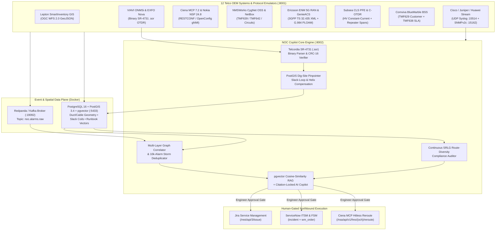

# Pandita AI — Autonomous Telco NOC, Fibre-Cut Assurance & SRLG Resilience Copilot

> **From 10,000 Raw Multi-Vendor Alarms → 1 Verified Physical Root Cause → Exact Dig-Site Coordinates & Gated Remediation in Seconds.**

An end-to-end, protocol-authentic **Network Operations Center (NOC) & Outside-Plant (OSP) Fibre Assurance Copilot** built for converged mobile/fixed operators (**du / e&**), pure-play metro fibre & data-centre interconnect operators (**Constl**), high-scale RAN + microwave + metro fibre operators (**Vodafone Idea / Vi**), and subsea + wholesale DCI carriers (**PCCW Global / HKT**).

Unlike superficial AI chatbots that hallucinate network state, this platform strictly separates:
1. **Deterministic Physics, Geometry & Graph Engines** — Byte-level Telcordia SR-4731 Rev 2 (`.sor`) binary OTDR trace parsing, PostGIS street-trench interpolation with manhole slack-loop & helical stranding compensation, 6-layer topological root-cause correlation, and Shared-Risk Link Group (SRLG) route-diversity auditing.
2. **Citation-Locked AI Copilot & `pgvector` Semantic RAG** — Retrieves operator Method of Procedure (MOP) runbooks and similar historical outages via PostgreSQL `pgvector` cosine similarity, synthesizes an evidence-locked engineering brief (via Anthropic Claude / OpenAI GPT or deterministic fallback), and stages **human-gated northbound actions** across **Jira Service Management**, **ServiceNow ITSM/FSM**, and **Ciena MCP**.

---

## System Architecture



---

## Key Capabilities & Technical Highlights

### 1. Genuine Binary Telcordia SR-4731 Rev 2 (`.sor`) OTDR Codec (`shared/sor_codec.py`)
- Implements a real binary parser and generator for **Telcordia SR-4731 Issue 2** `.sor` reflectogram files (`Map`, `GenParams`, `SupParams`, `FxdParams`, `KeyEvents`, 1000-point `DataPts` Rayleigh backscatter curve with fusion splice loss steps and Fresnel reflection spikes, and `Cksum` **CRC-16-CCITT** `0x1021` verification).
- Engineers can download live `.sor` binary traces from the VIAVI ONMSi / EXFO Nova emulator or upload external `.sor` files directly in the UI for instant parsing and PostGIS localization.

### 2. PostGIS Slack-Coil & Helical Stranding Dig-Site Localization (`backend/app/engine.py`)
- Raw OTDR distance measures **optical glass length**, not street trench distance. Sending a field crew to the raw OTDR meter mark regularly puts them **150m–300m away from the actual break** (or on the wrong side of a canal/bridge).
- Our PostGIS localization engine (`locate_fault_on_cable_postgis`) walks the splice plan from **Lepton GIS**, subtracts every upstream manhole's stored slack loop (`25m` POP / `15m` transit chamber), divides by the cable's helical stranding factor (`1.015x` loose-tube trunk / `1.012x` access), and interpolates the exact `[lat, lon]` along OSRM road-following duct geometry via `ST_LineInterpolatePoint`.
- Plots **both** the **True Slack-Corrected Dig Pin** and the **Naive Uncorrected Pin** on the MapLibre GIS canvas, displaying the exact **dispatch error avoided in meters**.

### 3. Continuous Shared-Risk Link Group (SRLG) Route-Diversity Auditor
- Enterprise customers pay premium rates for **Dual-Homed L3VPNs** and **1+1 Protected 100G/400G Wavelengths**, assuming their primary and secondary paths are physically disjoint.
- `audit_all_srlg_diversity()` traverses all 6 network layers (`Service Leg → DWDM OCh → Optical OMS → Fibre Cable → OSP Duct → Manhole Chamber / Bridge`) and automatically flags false diversity—such as **Emirates Gulf Bank's** dual-POP L3VPN sharing last-mile chamber `J_DG` and duct `D-DG-EGB`, or **Jebel Ali Logistics Cloud's** working and protect 100G wavelengths sharing the `QZ ↔ BB` trunk span.

### 4. Multi-Operator Archetype Support
Switchable in real time from the top navigation bar:

| Archetype ID | Operator Profile | Active Network Layers & Focus |
| :--- | :--- | :--- |
| **`du_converged`** | **Converged 4G/5G + Fibre + Enterprise** (*du / e& UAE archetype*) | Full 6-layer stack: OSP fibre, Ciena/Nokia DWDM, Cisco/Juniper IP/MPLS, Ericsson/Nokia 5G RAN hub-and-tail sites, GPON FTTH, and Enterprise SLAs. |
| **`constl_fiber`** | **Pure-Play Metro Fibre, Wavelength & DCI** (*Constl archetype*) | Dense metro trunk & access fibre, 100G/400G DWDM wavelengths, SRLG diversity enforcement, Lepton GIS slack modeling, and live 1625nm OTDR monitoring. |
| **`vi_india`** | **High-Scale 4G/5G RAN, Metro Fibre & Microwave** (*Vodafone Idea archetype*) | Multi-vendor 4G/5G RAN, 80 GHz E-Band microwave rain-fade vs. hardware fault disambiguation, rectifier AC mains / VRLA battery LVD countdowns, and municipal roadwork cuts. |
| **`pccw_subsea`** | **Global Subsea, Optical DCI & Wholesale Carrier** (*PCCW Global / HKT archetype*) | Subsea Cable Landing Station (`Jebel Ali CLS`), Power Feed Equipment (`PFE`) high-voltage shunt fault isolation, Coherent OTDR (`C-OTDR`) repeater span localization, and Pre-FEC BER / OSNR degradation tracking. |

### 5. Seven Built-In Real-World Telco Fault Scenarios

| # | Scenario ID | Scenario Title | Root Cause Isolated by Copilot | Gated Remediation Actions |
| :-: | :--- | :--- | :--- | :--- |
| **1** | `szr_canal_fibre_cut` | **Metro Trunk Fibre Cut + Hidden SRLG Failure (Sheikh Zayed Rd Canal)** | Physical break on 144F trunk `CBL-QZ-BB-01` (`7,780m` optical → `7,591m` trench, saving `189m` dig error); exposes SRLG violation on `SVC-JLC-WAVE-100G` + 3 cascaded 5G sites. | 1. Create Jira master incident<br>2. Dispatch ServiceNow FSM splice crew to `[25.1704, 55.2471]`<br>3. Hitless Ciena MCP reroute of `OCH-JLC-P` via `DSO-KRM` |
| **2** | `difc_gate_srlg_cut` | **Dual-Homed Bank HQ Outage via Shared Manhole Chamber (DIFC Gate)** | Contractor trench damage on duct `D-DG-EGB` severs both `CBL-DIFC-EGB-01` (Primary) and `CBL-BB-EGB-01` (Secondary) entering chamber `J_DG`. | 1. Create Jira P1 incident<br>2. Dispatch ServiceNow FSM splice crew to `J_DG` |
| **3** | `al_quoz_dying_gasp_vs_cut` | **Premises Power Blackout ('Dying Gasp') vs. Fibre Cut (Al Quoz)** | 24/24 GPON ONTs emit G.984 PLOAM `dying-gasp` within 650ms + VIAVI 1625nm OTDR proves `CBL-QZ-AQI-01` is 100% intact (`0.84 dB` loss). | **Suppresses false OSP fibre truck roll** & logs ServiceNow power-outage advisory |
| **4** | `dso_optical_degradation` | **Pre-Failure DWDM Pre-FEC BER & OSNR Degradation (Silicon Oasis AI DC)** | Nokia NSP OpenConfig gNMI reports Pre-FEC BER `8.4e-4` & OSNR `14.2 dB` on `OCH-SODC-AIR`, matched to a `+4.8 dB` non-reflective pinched splice on `CBL-AIR-DSO-01`. | Proactively shifts `OCH-SODC-AIR` via Ciena/Nokia controller before hard outage & schedules preventive splice re-seat |
| **5** | `ran_site_battery_lvd_countdown` | **5G Hub Site Rectifier AC Mains Loss & Battery LVD Countdown (`gNB-BB-01`)** | Commercial AC loss at `RAN_BB_HUB`; DC bus at `44.1V` approaching `43.2V` Low-Voltage Disconnect (`36 mins` remaining before 3 5G sites / 9 cells drop). | Dispatches Priority-1 Mobile Diesel Generator crew via ServiceNow FSM before LVD trip |
| **6** | `eband_microwave_rain_fade` | **80 GHz E-Band Microwave Rain-Fade vs. Hardware Fault (`gNB-DSO-04`)** | `42 mm/hr` rain squall drops RSL by `31.2 dB` (`-69.4 dBm`) on `MW-DSO-ACAD-80G`; ACM downshifts `1024QAM → QPSK` while protecting 5G VoNR EF queue. | **Suppresses false tower-climber ODU hardware replacement** & holds link in weather auto-clear watch |
| **7** | `pccw_subsea_shunt_fault` | **Subsea Wet-Plant Repeater Shunt Fault & C-OTDR Localization (`Jebel Ali CLS`)** | `PFE-JBL-01` voltage drops `+4,120V → +2,890V` (`318.5mA` earth leakage); C-OTDR pinpoints insulation shunt `412.6 km` seaward in Repeater Span `R07–R08` (`68m` depth). | Reconfigures PFE to single-end feed, alerts marine depot, and reroutes `OCH-JLC-W` via Ciena MCP |

---

## Repository Structure

```text
├── docker-compose.yml              # PostgreSQL 16 (PostGIS + pgvector) on :5433 & Redpanda Kafka on :19092
├── start.sh                        # Single-command launcher for Docker + Emulator + Backend + UI
├── requirements.txt                # Python 3.11+ dependencies
├── infra/
│   └── db/
│       ├── Dockerfile              # Custom pg16 image with PostGIS 3 + pgvector + pg_trgm
│       └── init.sql                # Extension bootstrap
├── shared/
│   └── sor_codec.py                # Binary Telcordia SR-4731 Rev 2 (.sor) OTDR generator, parser & CRC-16
├── emulators/
│   └── emu/
│       ├── spec.py                 # Ground-truth multi-layer network digital twin & 7 fault scenarios
│       ├── roads.py                # OSRM street-following duct geometry + manhole slack-coil builder
│       ├── road_cache.json         # Cached street coordinates for instant offline startup
│       └── server.py               # FastAPI Multi-OEM Emulator (:8001) + UDP Syslog/SNMP/Kafka emitters
├── backend/
│   └── app/
│       ├── db.py                   # PostGIS + pgvector schema, 12 connector configs & 6 seeded runbooks
│       ├── engine.py               # PostGIS fault pinpointer, SRLG auditor, correlator, pgvector RAG & 10k benchmark
│       └── main.py                 # NOC Copilot FastAPI server (:8002) + UDP Syslog/SNMP + Kafka consumer
├── frontend/                       # React 18 + TypeScript + Tailwind CSS + MapLibre GL Console (:5173)
│   ├── index.html                  # Plus Jakarta Sans & JetBrains Mono typography
│   └── src/
│       ├── App.tsx                 # Light/Dark theme modern NOC workspace & 4 primary views
│       └── components/
│           ├── OspMap.tsx          # Interactive MapLibre GL GIS map (Carto Positron Light & Dark Matter)
│           ├── OtdrTracePanel.tsx  # SVG SR-4731 reflectogram & Slack-to-Trench math panel
│           └── MultiLayerGraph.tsx # Interactive 6-layer physical-to-SLA dependency graph
├── tests/
│   └── test_noc_copilot.py         # End-to-end pytest suite verifying all 7 scenarios, .sor CRC & benchmark
└── docs/
    └── ARCHITECTURE_AND_PROTOCOLS.md # Detailed OEM protocol schemas, data requirements & mathematical formulas
```

---

## Quick Start

### Prerequisites
- **Docker & Docker Compose** (for PostgreSQL 16 + PostGIS + `pgvector` and Redpanda Kafka)
- **Python 3.11+**
- **Node.js 18+ & npm**

### Option A: Single-Command Startup
```bash
# 1. Create Python virtual environment and install dependencies (first time only)
python3 -m venv .venv
.venv/bin/pip install -r requirements.txt
(cd frontend && npm install)

# 2. Launch the entire stack (PostGIS + Redpanda + Emulator :8001 + Copilot API :8002 + UI :5173)
./start.sh
```
Then open **`http://127.0.0.1:5173`** in your browser.

### Option B: Step-by-Step Startup (Separate Terminals)
```bash
# 1. Start PostGIS (:5433) and Redpanda Kafka (:19092)
docker compose up -d

# 2. Start Multi-OEM Telco Emulator Suite (:8001)
PYTHONPATH=$(pwd) .venv/bin/uvicorn emulators.emu.server:app --host 127.0.0.1 --port 8001

# 3. Start NOC Copilot Backend API (:8002)
PYTHONPATH=$(pwd) .venv/bin/uvicorn backend.app.main:app --host 127.0.0.1 --port 8002

# 4. Start Frontend Dev Server (:5173)
cd frontend && npm run dev
```

---

## Verification & Testing

Run the automated end-to-end test suite (validates binary `.sor` round-trip & CRC-16 verification, PostGIS slack-loop localization, SRLG violation detection, `pgvector` runbook cosine similarity, 3GPP TS 32.435 XML PM counters, and the 10,000-alarm storm benchmark):

```bash
PYTHONPATH=$(pwd) .venv/bin/pytest tests/test_noc_copilot.py -v
```

Build the production frontend bundle:
```bash
cd frontend && npm run build
```

---

## Connecting Live LLM Keys & Live Customer Endpoints

1. **AI Model Configuration (Anthropic Claude / OpenAI GPT):**
   - Click **`AI Key`** in the top-right header of the UI (`http://127.0.0.1:5173`) or `POST /api/v1/settings/llm` with your Anthropic or OpenAI API key.
   - All physical fault localization, OTDR binary parsing, and SRLG graph audits always execute deterministically first; the LLM synthesizes the executive incident brief and MOP strictly grounded in that verified evidence bundle.
2. **Switching Any of the 12 OEM Connectors from Emulator to Live:**
   - Navigate to **`12 OEMs & Storm Benchmark`** in the top navigation bar, click **`Configure`** on any connector (e.g., **Jira Service Management**, **ServiceNow ITSM**, **NetBox**, **Lepton GIS WFS**, **Ciena MCP**, **VIAVI ONMSi**), change mode from `emulator` to `live`, and enter your production/lab base URL.
