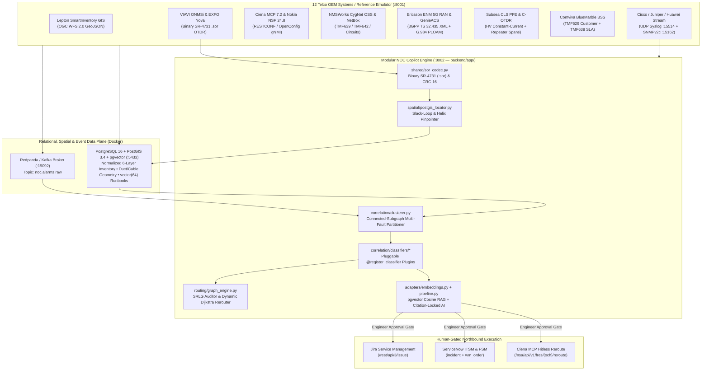

# Pandita AI — Autonomous Telco NOC, Fibre-Cut Assurance & SRLG Resilience Copilot

> **From 10,000 Raw Multi-Vendor Alarms → Connected Causal Graph Clusters → Exact Slack-Compensated Dig Coordinates & Gated Remediation in Seconds.**

An end-to-end, topology-agnostic, protocol-authentic **Network Operations Center (NOC) & Outside-Plant (OSP) Fibre Assurance Platform** built for converged mobile/fixed operators (**du / e&**), pure-play metro fibre & data-centre interconnect operators (**Constl**), high-scale RAN + microwave + metro fibre operators (**Vodafone Idea / Vi**), and subsea + wholesale DCI carriers (**PCCW Global / HKT**).

Unlike demo prototypes that hardcode topology rules or let chatbots guess network state, this platform enforces:
1. **100% Topology-Agnostic Modular Engine (`backend/app/`)** — Normalized 6-layer PostgreSQL + PostGIS inventory (`osp_ducts`, `osp_cables`, `oms_links`, `optical_channels`, `ip_links`, `ran_sites`, `gpon_clusters`, `subsea_cables`, `customer_services`), connected-subgraph multi-fault alarm clustering, dynamic NetworkX Dijkstra optical rerouting, and pluggable `@register_classifier` strategy plugins. Enforced on every commit by [`scripts/check_no_hardcoded_topology.py`](scripts/check_no_hardcoded_topology.py).
2. **Deterministic Physics & Spatial Geometry** — Byte-level Telcordia SR-4731 Rev 2 (`.sor`) binary OTDR parsing & CRC-16 verification (`shared/sor_codec.py`), PostGIS street-trench interpolation subtracting upstream manhole slack coils & helical stranding, and continuous Shared-Risk Link Group (SRLG) route-diversity auditing.
3. **Citation-Locked AI Copilot & `pgvector` Semantic RAG** — Retrieves operator Method of Procedure (MOP) runbooks from `backend/app/knowledge/runbooks.json` via `pgvector` `vector(64)` cosine similarity, synthesizes an evidence-locked engineering brief (`Anthropic Claude` / `OpenAI GPT` or deterministic fallback), and stages **human-gated northbound actions** across **Jira Service Management**, **ServiceNow ITSM/FSM**, and **Ciena MCP**.

---

## New Team Member? Start Here (Zero Telecom Background Required!)

We wrote a complete **Software Engineer Onboarding Suite** so any backend or frontend developer can contribute effectively on Day 1 without prior telecom experience:

| Guide | Read Time | What You Will Learn |
| :--- | :-: | :--- |
| **[`docs/01_TELCO_PRIMER_FOR_ENGINEERS.md`](docs/01_TELCO_PRIMER_FOR_ENGINEERS.md)** | 15 min | Visual crash course translating OSP slack loops, `.sor` Fresnel spikes, DWDM `OCh`/`OMS`/`Pre-FEC BER`/`SOP`, GPON `Dying Gasp`, 5G `LVD`, E-Band `ACM`, and `SRLG` into CS primitives + full Acronym Glossary. |
| **[`docs/02_SYSTEM_ARCHITECTURE_AND_DATA_FLOW.md`](docs/02_SYSTEM_ARCHITECTURE_AND_DATA_FLOW.md)** | 10 min | Normalized PostgreSQL/PostGIS table reference, multi-fault graph clustering algorithm, and `@register_classifier` plugin lifecycle. |
| **[`docs/03_DEVELOPER_CONTRIBUTION_GUIDE.md`](docs/03_DEVELOPER_CONTRIBUTION_GUIDE.md)** | 10 min | Copy-paste recipes for adding a new `HypothesisClassifier`, loading a new city dataset (`TELCO_DATASET_PATH`), adding typed React views, and passing CI gates. |
| **[`docs/04_API_AND_CONNECTOR_CONTRACTS.md`](docs/04_API_AND_CONNECTOR_CONTRACTS.md)** | Ref | Complete REST API endpoints, TMF642 JSON schema, 12-OEM connector protocols, and mathematical formulas. |
| **[`CONTRIBUTING.md`](CONTRIBUTING.md)** | 3 min | Branching workflow, anti-hardcoding rules, Light/Dark UI parity, and PR checklist. |

---

## System Architecture



---

## Multi-Operator Archetypes & Built-In Reference Scenarios

Switchable in real time from the top navigation bar (reference topology loaded declaratively from [`emulators/datasets/dubai_metro.json`](emulators/datasets/dubai_metro.json), swappable via `TELCO_DATASET_PATH`):

| Archetype ID | Operator Profile | Active Network Layers & Focus |
| :--- | :--- | :--- |
| **`du_converged`** | **Converged 4G/5G + Fibre + Enterprise** (*du / e& UAE archetype*) | Full 6-layer stack: OSP fibre, Ciena/Nokia DWDM, Cisco/Juniper IP/MPLS, Ericsson/Nokia 5G RAN hub-and-tail sites, GPON FTTH, and Enterprise SLAs. |
| **`constl_fiber`** | **Pure-Play Metro Fibre, Wavelength & DCI** (*Constl archetype*) | Dense metro trunk & access fibre, 100G/400G DWDM wavelengths, SRLG diversity enforcement, Lepton GIS slack modeling, and live 1625nm OTDR monitoring. |
| **`vi_india`** | **High-Scale 4G/5G RAN, Metro Fibre & Microwave** (*Vodafone Idea archetype*) | Multi-vendor 4G/5G RAN, 80 GHz E-Band microwave rain-fade vs. hardware fault disambiguation, rectifier AC mains / VRLA battery LVD countdowns, and civil roadwork cuts. |
| **`pccw_subsea`** | **Global Subsea, Optical DCI & Wholesale Carrier** (*PCCW Global / HKT archetype*) | Subsea Cable Landing Station (`CLS`), Power Feed Equipment (`PFE`) high-voltage shunt fault isolation, Coherent OTDR (`C-OTDR`) repeater span localization, and Pre-FEC BER tracking. |

### Seven Verified End-to-End Fault Scenarios

| # | Scenario ID | Classifier Plugin | Root Cause Isolated & Gated Actions |
| :-: | :--- | :--- | :--- |
| **1** | `szr_canal_fibre_cut` | `physical_fiber_duct_cut` | Reflective `.sor` break on 144F trunk (`7,780m` optical → `7,591m` trench, avoiding `189m` dig error); dynamically computes disjoint inland Dijkstra reroute + ServiceNow FSM crew dispatch. |
| **2** | `difc_gate_srlg_cut` | `physical_fiber_duct_cut` | Civil trench damage severs dual cables inside shared duct `D-DG-EGB` / chamber `J_DG`, exposing hidden SRLG breach on dual-homed bank L3VPN. |
| **3** | `al_quoz_dying_gasp_vs_cut` | `power_dying_gasp` | G.984 `dying-gasp` burst + live 1625nm `.sor` continuity check confirms utility AC blackout → **suppresses false OSP splicing truck roll**. |
| **4** | `dso_optical_degradation` | `optical_degradation_tca` | Pre-FEC BER (`8.4e-4`) & OSNR (`14.2 dB`) TCA matched to `+4.8 dB` non-reflective pinched splice → proactively shifts 100G wave before FEC cliff. |
| **5** | `ran_site_battery_lvd_countdown` | `ran_site_power_lvd` | Commercial AC loss at 5G hub site (`44.1V` approaching `43.2V` LVD, `36m` left before 3-site cascade) → dispatches emergency mobile diesel generator. |
| **6** | `eband_microwave_rain_fade` | `microwave_weather_fade` | `42 mm/hr` rain squall attenuates 80 GHz link (`-69.4 dBm`) with automatic `ACM -> QPSK` downshift → **suppresses false tower-climber ODU replacement**. |
| **7** | `pccw_subsea_shunt_fault` | `subsea_wetplant_shunt` | CLS `PFE` voltage drop (`+2,890V`, `318.5mA` earth leakage) + `C-OTDR` shunt at `412.6 km` → stages single-end PFE feed & terrestrial DCI wave reroute. |

---

## Modular Repository Structure

```text
├── .github/
│   ├── workflows/ci.yml            # GitHub Actions CI (PostGIS + anti-hardcoding + pytest + tsc/vite)
│   └── PULL_REQUEST_TEMPLATE.md    # Team PR checklist
├── docker-compose.yml              # PostgreSQL 16 (PostGIS + pgvector) on :5433 & Redpanda on :19092
├── pyproject.toml                  # Python package & pytest configuration
├── requirements.txt                # Python 3.11+ dependencies
├── start.sh                        # Single-command launcher for Docker + Emulator + Backend + UI
├── scripts/
│   └── check_no_hardcoded_topology.py # CI gate verifying zero topology IDs inside backend/app/
├── shared/
│   └── sor_codec.py                # Binary Telcordia SR-4731 Rev 2 (.sor) generator, parser & CRC-16
├── emulators/
│   ├── datasets/
│   │   └── dubai_metro.json        # Declarative reference topology dataset (swappable via TELCO_DATASET_PATH)
│   └── emu/
│       ├── spec.py                 # Declarative JSON dataset loader
│       ├── roads.py                # OSRM street-following geometry + SHA-256 topology cache
│       └── server.py               # FastAPI 12-OEM Protocol Emulator (:8001) + Syslog/SNMP/Kafka
├── backend/
│   └── app/
│       ├── db.py                   # Normalized 6-layer PostGIS + pgvector schema & connector store
│       ├── main.py                 # NOC Copilot FastAPI routes (:8002) + UDP/Kafka consumers
│       ├── engine.py               # Clean public facade re-exporting modular subsystems
│       ├── schemas/                # Typed Pydantic API, alarm, cluster & hypothesis contracts
│       ├── adapters/               # Southbound/Northbound OEM interfaces, registry & 64-d embeddings
│       ├── spatial/                # PostGIS slack-coil & helical stranding street localizer
│       ├── routing/                # Dynamic NetworkX Dijkstra rerouter, SRLG auditor & 6-layer DAG
│       ├── correlation/            # Connected-subgraph clusterer, pipeline & 6 @register_classifier plugins
│       └── knowledge/
│           └── runbooks.json       # Declarative MOP runbook corpus indexed into pgvector
├── frontend/                       # React 18 + TypeScript + Tailwind CSS + MapLibre GL (:5173)
│   └── src/
│       ├── App.tsx                 # Top-level theme/navigation shell
│       ├── types/api.ts            # Strict TypeScript interfaces mirroring backend contracts
│       ├── api/client.ts           # Typed API client
│       ├── views/                  # WorkspaceView, TopologyView, TelemetryView, ConnectorsView
│       └── components/             # OspMap, OtdrTracePanel, MultiLayerGraph, ConfigModals
├── tests/
│   ├── test_noc_copilot.py         # Binary .sor, all 7 scenarios, 3GPP XML & 10k storm tests
│   └── test_architecture_and_graph.py # Anti-hardcoding, Dijkstra reroute & concurrent multi-fault tests
└── docs/                           # 01..04 Developer Onboarding & Architecture Guides
```

---

## Quick Start & Verification

```bash
# 1. Install dependencies (first time only)
python3 -m venv .venv
.venv/bin/pip install -r requirements.txt
(cd frontend && npm install)

# 2. Launch PostGIS + Redpanda + Emulator (:8001) + Backend (:8002) + UI (:5173)
./start.sh
```
Open **`http://127.0.0.1:5173`** in your browser.

### Run All Engineering Gates
```bash
# Gate 1: Verify zero hardcoded topology IDs in backend/app/
.venv/bin/python scripts/check_no_hardcoded_topology.py

# Gate 2: Run full integration & multi-fault graph test suite
.venv/bin/pytest -v

# Gate 3: Run strict TypeScript check + Vite production build
(cd frontend && npm run build)
```
