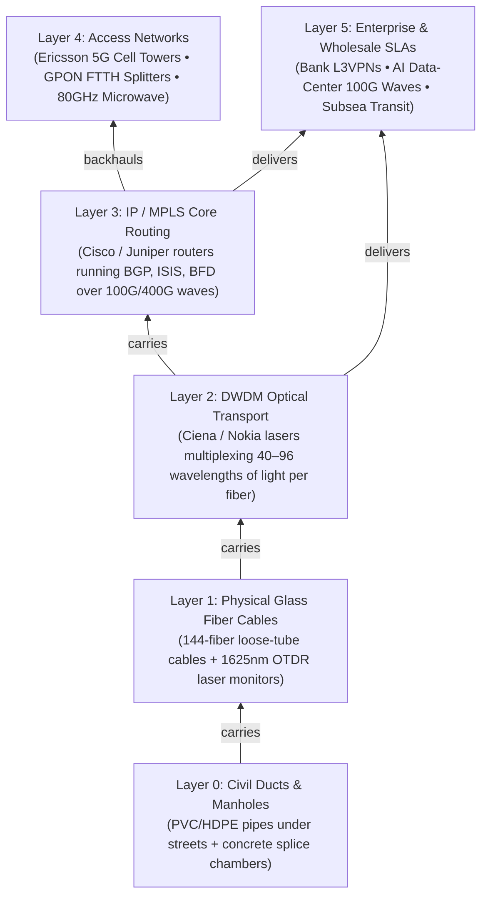

# 01 — Telecom Domain Primer for Software Engineers

> **Audience:** Full-stack, backend, data, and frontend engineers joining the **Pandita AI NOC Copilot** team with **zero prior telecommunications experience**.
> **Goal:** Translate telecom physics, acronyms, and OEM protocols directly into familiar Computer Science primitives (**graphs, byte streams, coordinate geometry, and state machines**) in 15 minutes.

---

## 1. The Big Picture: Why a Single Excavator Shovel Triggers 40+ Alarms

When a construction crew's JCB excavator accidentally snaps an underground fiber cable on Sheikh Zayed Road, a telecom operator's Network Operations Center (NOC) does **not** receive a clean message saying `"Cable X broke at [25.1704, 55.2471]"`.

Instead, **6 stacked layers of equipment** built by **8–12 different hardware vendors** all lose connectivity within milliseconds and scream simultaneously:



### Software Engineering Mental Model
Think of the entire telecom network as a **6-layer Directed Acyclic Graph (DAG)** stored in PostgreSQL:
- **Bottom nodes (`osp_ducts`, `osp_cables`)** are physical assets in the ground (`LineString` geometries in PostGIS).
- **Middle nodes (`oms_links`, `optical_channels`, `ip_links`)** are logical tunnels riding over those cables.
- **Top nodes (`ran_sites`, `gpon_clusters`, `customer_services`)** are revenue-bearing endpoints.
- **Root-Cause Correlation** is simply **finding the lowest-layer faulted ancestor** in a connected subgraph of alarms—while ruling out non-fiber impostors like **power blackouts** and **heavy rainstorms**!

---

## 2. Core Physics Concepts (Translated to Code)

### 2.1 Outside Plant (OSP), Manhole Slack Coils & Helical Stranding
**The Problem:** When a fiber cable breaks, an optical laser instrument called an **OTDR** measures how far light traveled through the glass before bouncing back—say **`7,780 meters`**.
If you plot `7,780 meters` along the street map from the origin building, **you will send the repair truck ~190 meters past the actual break** (often onto the wrong side of a highway or canal!).

**Why?** Two physical reasons:
1. **Manhole Slack Coils (`slack_coil_m`):** Every ~500m–2km underground, cables pass through a concrete chamber (**manhole / handhole**). Technicians intentionally coil up **`15m–25m` of extra fiber loop** on the chamber wall so future repair vans can pull the splice tray up into an air-conditioned truck on the surface. Light travels through every meter of those coiled loops, even though the loops sit at a single `[lat, lon]` point!
2. **Helical Stranding (`helix_factor`, ~`1.015`):** Inside a heavy armored cable, glass fibers are twisted in a spiral helix around a central strength rod so the glass doesn't snap when the cable bends around street corners. Thus `1.015 meters` of glass equals `1.000 meter` of street trench.

**The Exact Formula in [`postgis_locator.py`](../backend/app/spatial/postgis_locator.py):**
```text
net_fiber_m  = optical_distance_m - sum(upstream_manhole_slack_coils_m)
trench_m     = net_fiber_m / cable.helix_factor
dig_lat_lon  = PostGIS ST_LineInterpolatePoint(cable.geom, trench_m / cable.trench_length_m)
```

---

### 2.2 OTDR & Binary Telcordia SR-4731 (`.sor`) Files
An **OTDR (Optical Time-Domain Reflectometer)** is radar for glass fiber. From a central office (**POP**), it fires pulses of **1625 nm** or **1650 nm** infrared light (out-of-band from live customer traffic at **1550 nm**) and measures **Rayleigh backscatter** returning over time.

Every OTDR vendor (**VIAVI**, **EXFO**, **Yokogawa**, **Anritsu**) exports traces in a universal 1990s little-endian binary format called **Telcordia SR-4731 Rev 2 (`.sor`)**, implemented byte-for-byte in [`shared/sor_codec.py`](../shared/sor_codec.py):

| Event Signature on `.sor` Graph | Physical Meaning | Event Code | What NOC Copilot Does |
| :--- | :--- | :--- | :--- |
| **Small downward step (`0.05–0.2 dB`), NO upward spike** | Normal fusion splice joining two cables in a manhole | `0F9999LS` | Uses known splice distances as landmarks |
| **Large downward step (`+4.8 dB`), NO upward spike** | **Macro-bend / pinched fiber** (crushed tray or tight bend leaking light, glass not broken yet) | `0F9999LS` | Triggers proactive wavelength reroute (`OpticalDegradationClassifier`) |
| **Sharp upward spike (`Fresnel reflection`) followed by cliff to noise floor** | **Clean physical break / JCB cut** (glass-to-air gap acts like a mirror!) | `1E9999LS` | Runs PostGIS slack-loop math & stages splice crew dispatch (`PhysicalFiberDuctCutClassifier`) |

---

### 2.3 DWDM: `OMS`, `OCh`, `OSNR`, `Pre-FEC BER` & `SOP`
- **DWDM (Dense Wavelength Division Multiplexing):** Instead of 1 laser per fiber, Ciena/Nokia transponders shine **40 to 96 different colors (wavelengths / `THz` frequencies)** through the same strand of glass—each carrying `100 Gbps` or `400 Gbps`.
- **`OMS` (Optical Multiplex Section):** A physical POP-to-POP amplified fiber span carrying all wavelengths together. Stored in DB table `oms_links`.
- **`OCh` (Optical Channel / Wavelength):** A single end-to-end `100G`/`400G` circuit riding across multiple `OMS` hops (`path_nodes_json`, e.g. `["JBL", "QZ", "BB", "DIFC"]`). Stored in DB table `optical_channels`.
- **`OSNR` (Optical Signal-to-Noise Ratio, `dB`):** How clean the laser signal is above optical amplifier noise. Healthy is `24–28 dB`; below `~15 dB` approaches failure.
- **`Pre-FEC BER` vs. `Post-FEC BER`:** Modern optical modems include **Forward Error Correction (FEC)**—error-correcting math that fixes bit errors on the fly:
  - Normal `Pre-FEC BER` is `~1e-6` (`1` bad bit per million, 100% corrected so `Post-FEC BER = 0`, customer sees **zero packet loss**).
  - If a splice gets pinched, `Pre-FEC BER` degrades to `8.4e-4`. Customer traffic is *still* error-free (`Post-FEC = 0`), **but the link is 1 dB away from the "FEC Cliff"** where traffic will suddenly drop 100%. Catching `Pre-FEC BER` early lets us reroute hitlessly before any outage!
- **`SOP` (State of Polarization, `rad/s`):** Mechanical vibrations in the soil (like a JCB excavator digging 2 meters above a buried duct) shake the glass fiber and rotate the polarization state of coherent laser light from `<5 rad/s` to **`150–800+ rad/s`** *minutes before* the bucket hits the pipe!

---

### 2.4 False-Cut Impostors (How Copilot Saves \$5,000 Wasted Truck Rolls)
Not every "Loss of Signal" alarm is a fiber cut! Three classic impostors fool naive NOC rules every day:

1. **GPON `Dying Gasp` (Premises AC Power Blackout):**
   - Home/office fiber modems (**ONTs**) have a tiny capacitor holding ~5 milliseconds of charge. When neighborhood electricity fails, all 24–64 ONTs on a passive optical splitter (`gpon_clusters`) transmit a final 1-bit ITU-T G.984 `dying-gasp` message right before going dark.
   - If `dying_gasp` arrives **AND** our 1625nm OTDR trace shows the fiber cable is 100% intact (`no_cut_verified`), **do NOT send a fiber splicing van**—it's a utility power outage! (`PowerDyingGaspClassifier`)
2. **5G Hub Site Battery `LVD` (Low-Voltage Disconnect):**
   - Cell towers (`ran_sites`) run on `-48V DC` rectifiers backed by batteries. When commercial AC power fails, batteries drain from `53.8V` down toward **`43.2V` (`LVD`)**. At `43.2V`, the cabinet disconnects batteries to prevent permanent chemical ruin—dropping the hub tower **and every downstream "tail" tower daisy-chained through it**. Dispatching a mobile diesel generator *before* `43.2V` prevents a multi-tower blackout! (`RanSitePowerLvdClassifier`)
3. **80 GHz E-Band Microwave Rain Fade (`ACM`):**
   - Some 5G towers connect via millimeter-wave radio (`80 GHz`) instead of underground fiber. Heavy rain (`>35 mm/hr`) absorbs 80 GHz radio waves, dropping Received Signal Level (`RSL`) by `30 dB`. Healthy radios automatically step down modulation (**ACM: Adaptive Coding & Modulation**) from `1024QAM` (`10 Gbps`) to `QPSK` (`650 Mbps`), keeping high-priority voice (`VoNR`) alive until the rain cloud passes in 15 minutes. **Never dispatch a tower climber to replace healthy radio hardware during a rainstorm!** (`MicrowaveWeatherFadeClassifier`)

---

### 2.5 Shared-Risk Link Group (`SRLG`) — The "Fake Redundancy" Trap
Banks and cloud providers pay high fees for **physically diverse Primary + Secondary circuits**. Sales engineers often provision:
- **Primary Leg:** Customer HQ → DIFC POP
- **Secondary Leg:** Customer HQ → Business Bay POP

On a logical Visio diagram, those look 100% redundant! **In reality**, outside the customer building, **both cables were pulled through the exact same concrete duct (`D-DG-EGB`) and manhole (`J_DG`)** for the first 300 meters. That shared duct/chamber is an **SRLG violation**—one excavator scoop takes down both Primary and Secondary simultaneously!
[`audit_all_srlg_diversity()`](../backend/app/routing/graph_engine.py) walks all 6 layers in PostgreSQL (`customer_services -> optical_channels -> oms_links -> osp_cables -> osp_ducts / chambers / bridges`) and flags every hidden SRLG overlap automatically.

---

### 2.6 Subsea Wet-Plant & `PFE` Shunt Faults (PCCW Global Archetype)
Undersea cables (`subsea_cables`) have optical amplifiers (**repeaters**) on the ocean floor every `60–80 km`. Because there are no power outlets underwater, the **Cable Landing Station (CLS)** on shore uses **Power Feed Equipment (`PFE`)** to pump **`+4,000V DC` constant current** down a copper tube inside the cable, using the ocean itself as ground return.
If a ship anchor scrapes the cable insulation `412 km` offshore without snapping the glass fibers (**a shunt fault**), current leaks into seawater, `PFE` voltage drops (`+4,120V -> +2,890V`), and **Coherent OTDR (`C-OTDR`)** pinpoints which repeater span (`R07–R08`) needs single-end power reconfiguration (`SubseaWetPlantShuntClassifier`).

---

## 3. Master Acronym-to-Code Glossary

| Telecom Acronym | Plain-English Meaning | Where It Lives in Code / DB |
| :--- | :--- | :--- |
| **ACM** | Adaptive Coding & Modulation (radio auto-slows in rain instead of dropping) | [`microwave_weather.py`](../backend/app/correlation/classifiers/microwave_weather.py) |
| **BFD** | Bidirectional Forwarding Detection (sub-50ms router heartbeat) | IP/MPLS alarms (`INTERFACE_LINK_BFD_DOWN`) |
| **BSS / OSS** | Business Support Systems (customers/SLAs) / Operations Support Systems (inventory/alarms) | `customers`, `sla_tiers`, `customer_services` tables |
| **CLS / PFE** | Cable Landing Station / Power Feed Equipment (high-voltage DC subsea power supply) | `subsea_cables` table, [`subsea_wetplant.py`](../backend/app/correlation/classifiers/subsea_wetplant.py) |
| **DWDM** | Dense Wavelength Division Multiplexing (many laser colors on 1 fiber) | `oms_links`, `optical_channels` tables |
| **FSM / ITSM** | Field Service Management (`wm_order` truck rolls) / IT Service Management (`incident`) | ServiceNow & Jira connectors |
| **gNodeB (`gNB`)** | 5G Radio Base Station (cell tower) | `ran_sites` table |
| **GPON / OLT / ONT** | Passive Optical Network: `OLT` (POP headend) → passive splitter → `ONT` (home/office fiber box) | `gpon_clusters` table, [`power_dying_gasp.py`](../backend/app/correlation/classifiers/power_dying_gasp.py) |
| **LVD** | Low-Voltage Disconnect (`43.2V` battery cutoff threshold at a cell site) | [`ran_power_lvd.py`](../backend/app/correlation/classifiers/ran_power_lvd.py) |
| **MOP / RFO** | Method of Procedure (step-by-step repair runbook) / Reason for Outage (post-mortem report) | [`runbooks.json`](../backend/app/knowledge/runbooks.json), `runbooks` table |
| **MTTR** | Mean Time To Repair (contractual SLA repair clock, e.g., `4.0 hours` for Platinum) | `sla_tiers` table |
| **OCh / OMS** | Optical Channel (single 100G/400G wave) / Optical Multiplex Section (amplified fiber span) | `optical_channels`, `oms_links` tables |
| **OSP** | Outside Plant (physical ducts, manholes, trenches, splices, and cables outdoors) | `osp_ducts`, `osp_manholes`, `osp_cables` PostGIS tables |
| **OTDR / RFTS** | Optical Time-Domain Reflectometer / Remote Fiber Test System (`1625nm` automated OTDR) | [`sor_codec.py`](../shared/sor_codec.py), `rfts_units` table |
| **POP** | Point of Presence (carrier facility housing optical ROADMs and core routers) | `network_nodes` (`kind = 'pop'`) |
| **Pre-FEC BER** | Bit Error Rate *before* Forward Error Correction math (early-warning optical health metric) | [`optical_degradation.py`](../backend/app/correlation/classifiers/optical_degradation.py) |
| **ROADM** | Reconfigurable Optical Add-Drop Multiplexer (optical switch steering wavelengths across fibers) | Ciena MCP / Nokia NSP controllers |
| **RSL / SNR** | Received Signal Level (`dBm`) / Signal-to-Noise Ratio (`dB`) on wireless links | Microwave PM telemetry |
| **`.sor` (SR-4731)** | Standard binary file format for OTDR reflectogram traces + CRC-16 checksum | [`shared/sor_codec.py`](../shared/sor_codec.py) |
| **SRLG** | Shared-Risk Link Group (hidden physical duct/manhole/bridge shared by "redundant" circuits) | [`audit_all_srlg_diversity()`](../backend/app/routing/graph_engine.py) |
| **TMF642 / TMF639** | TM Forum standard JSON REST schemas for Alarms (`TMF642`) and Resource Inventory (`TMF639`) | `POST /api/v1/ingest/tmf642` |
