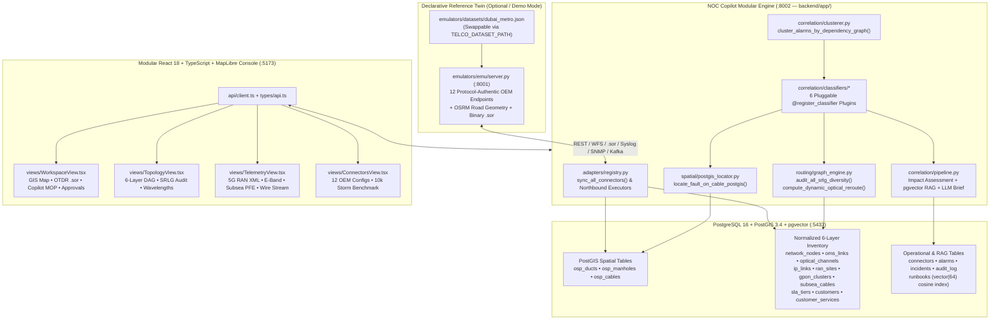
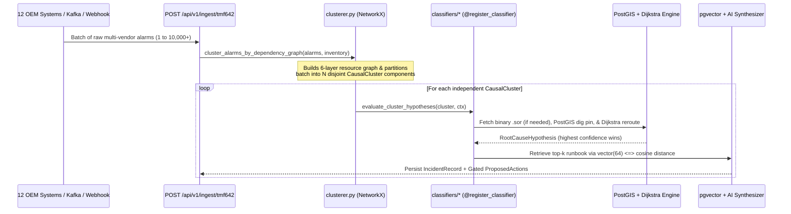

# 02 — System Architecture, Normalized Schema & Correlation Pipeline

> **Audience:** Software engineers working on backend services (`backend/app/`), data models (`db.py`), OEM adapters (`adapters/`), or frontend views (`frontend/src/`).

---

## 1. Architectural Principles

1. **Strict Topology-Agnosticism (`backend/app/`):**
   - Zero city names, node IDs, cable IDs, router names, or static reroute paths are permitted anywhere inside `backend/app/`.
   - Enforced on every test run and pull request by [`scripts/check_no_hardcoded_topology.py`](../scripts/check_no_hardcoded_topology.py).
   - Reference topologies live exclusively as declarative JSON datasets (`emulators/datasets/dubai_metro.json`, swappable via `TELCO_DATASET_PATH`) or live OEM inventory feeds synced into normalized PostgreSQL/PostGIS tables.
2. **Deterministic Physics & Graph Math First, Citation-Locked AI Second:**
   - Binary `.sor` parsing, PostGIS slack-loop coordinate math, graph-based multi-fault clustering, SRLG diversity audits, and NetworkX Dijkstra reroute pathfinding execute deterministically in Python + PostGIS.
   - The LLM (`Anthropic Claude` / `OpenAI GPT` or deterministic offline synthesizer) receives only the verified mathematical evidence bundle + `pgvector` runbooks and **cannot hallucinate coordinates or execute unapproved actions**.
3. **Human-Gated Northbound Execution:**
   - Classifiers propose typed `ProposedAction` records (`PENDING_APPROVAL`). Nothing mutates Jira, ServiceNow, or optical SDN controllers (`Ciena MCP` / `Nokia NSP`) until an operator approves via `POST /api/v1/incidents/{id}/approve`.

---

## 2. End-to-End Package Map

---

## 3. Normalized Relational & PostGIS Database Schema ([`backend/app/db.py`](../backend/app/db.py))

All network layers are stored as first-class relational tables in PostgreSQL so correlation, SRLG auditing, and Dijkstra routing work identically whether inventory came from the emulator or a live customer OSS/GIS:

| Layer | Table Name | Primary Key | Key Columns & Purpose |
| :--- | :--- | :--- | :--- |
| **L0 Civil** | `osp_ducts` | `id` | `node_a`, `node_b`, `bridge`, `trench_length_m`, `geom GEOMETRY(LineString, 4326)` |
| **L0 Civil** | `osp_manholes` | `id` | `node_id`, `name`, `kind`, `slack_coil_m`, `geom GEOMETRY(Point, 4326)` |
| **L0/L1** | `network_nodes` | `id` | `name`, `kind` (`pop`, `junction`, `customer`, `cellsite`), `lat`, `lon`, `router_vendor`, `optical_vendor` |
| **L1 Fiber** | `osp_cables` | `id` | `path_nodes`, `duct_ids`, `fibres`, `role`, `helix_factor`, `trench_length_m`, `optical_length_m`, `splices_json`, `geom GEOMETRY(LineString, 4326)` |
| **L1 Test** | `rfts_units` | `id` | `pop_node`, `vendor`, `model`, `wavelength_nm`, `monitored_cables_json` |
| **L2 DWDM** | `oms_links` | `id` | `node_a`, `node_b`, `cable_id`, `vendor` (maps optical POP spans to physical cables) |
| **L2 DWDM** | `optical_channels` | `id` | `rate` (`100G`/`400G`), `freq_thz`, `path_nodes_json`, `service_id`, `leg_name`, `controller_id` |
| **L3 IP** | `ip_links` | `id` | `node_a`, `node_b`, `underlay_id` (`OCh` or dark `osp_cable`), `protocol` |
| **L4 RAN** | `ran_sites` | `id` | `pop_anchor`, `backhaul_type`, `backhaul_cable_id`, `hub_site_id`, `mw_link_id`, `downstream_tails_json`, `battery_backup_hours` |
| **L4 GPON** | `gpon_clusters` | `id` | `olt_id`, `pop_node`, `feeder_cable_id`, `ont_count`, `district` |
| **L1/L2 Wet** | `subsea_cables` | `id` | `cls_node`, `landing_peers_json`, `length_km`, `repeater_count`, `pfe_id`, `carried_services_json` |
| **L5 BSS** | `sla_tiers` | `tier_name` | `mttr_hours`, `availability_pct`, `penalty_usd_per_hour` |
| **L5 BSS** | `customers` | `id` | `name`, `industry`, `sla_tier`, `node_id`, `account_manager` |
| **L5 BSS** | `customer_services` | `id` | `customer_id`, `service_type`, `bandwidth`, `ordered_diverse`, `legs_json` |
| **Knowledge** | `runbooks` | `id` | `title`, `domain`, `symptoms`, `procedure_md`, `embedding vector(64)` |
| **Ops** | `connectors` | `id` | `name`, `category`, `protocol`, `mode` (`emulator`/`live`), `endpoint_url`, `config_json` |
| **Ops** | `incidents` | `incident_id` | `root_cause_type`, `root_cause_resource`, `fault_location_json`, `impact_json`, `ai_copilot_json`, `proposed_actions_json` |

---

## 4. Correlation Sequence: How Raw Alarms Become Actionable Incidents

### Why Connected-Subgraph Clustering Matters (`clusterer.py`)
Naive demo systems assume **1 HTTP alarm batch == 1 incident**. In production, a 5-second Kafka window frequently contains alarms from **two completely unrelated faults** happening at the same time in different parts of the country (e.g., an Al Quoz GPON power outage + a Silicon Oasis 80 GHz rain fade).

[`cluster_alarms_by_dependency_graph()`](../backend/app/correlation/clusterer.py):
1. Builds an undirected dependency graph linking `Duct <-> Cable <-> OMS <-> OCh <-> IP <-> RAN/GPON <-> Service` (**deliberately excluding shared POP building envelopes** so two unrelated cables terminating in the same central office do not falsely merge!).
2. Induces the active subgraph over resources referenced in the alarm batch and extracts `nx.connected_components(...)`.
3. Emits **1 `CausalCluster` per connected fault tree**:
   - `28` cascading alarms across 6 OEMs from 1 JCB fiber cut → **1 `CausalCluster` → 1 Master Incident**.
   - `2` unrelated faults arriving in the exact same JSON batch → **2 `CausalCluster`s → 2 Independent Incidents** (verified in [`tests/test_architecture_and_graph.py`](../tests/test_architecture_and_graph.py)).

---

## 5. Built-In Pluggable Classifiers (`backend/app/correlation/classifiers/`)

Each classifier implements `HypothesisClassifier` and registers via `@register_classifier`:

| Priority | Classifier Module | `classifier_id` | What It Detects & Proposes |
| :-: | :--- | :--- | :--- |
| **95** | [`power_dying_gasp.py`](../backend/app/correlation/classifiers/power_dying_gasp.py) | `power_dying_gasp` | G.984 `dying-gasp` + live `.sor` continuity check → suppresses false splice truck roll |
| **92** | [`subsea_wetplant.py`](../backend/app/correlation/classifiers/subsea_wetplant.py) | `subsea_wetplant_shunt` | CLS `PFE` voltage drop / earth leakage + `C-OTDR` span → single-end feed + terrestrial wave reroute |
| **90** | [`ran_power_lvd.py`](../backend/app/correlation/classifiers/ran_power_lvd.py) | `ran_site_power_lvd` | 5G hub rectifier AC loss + battery `LVD` countdown → mobile diesel generator dispatch |
| **88** | [`microwave_weather.py`](../backend/app/correlation/classifiers/microwave_weather.py) | `microwave_weather_fade` | 80 GHz E-Band rain attenuation + `ACM` `QPSK` downshift → suppresses false ODU hardware climb |
| **85** | [`optical_degradation.py`](../backend/app/correlation/classifiers/optical_degradation.py) | `optical_degradation_tca` | Pre-FEC BER / OSNR degradation + non-reflective pinched splice → proactive Dijkstra wave shift |
| **50** | [`fiber_duct_cut.py`](../backend/app/correlation/classifiers/fiber_duct_cut.py) | `physical_fiber_duct_cut` | Reflective `.sor` break / hard optical LOS → PostGIS slack-loop dig pin + FSM crew + Dijkstra reroute |
| *Fallback* | [`base.py`](../backend/app/correlation/classifiers/base.py) | `generic_correlated_fallback` | Ensures arbitrary unknown TMF642 alarms correlate safely without throwing HTTP 500 |
